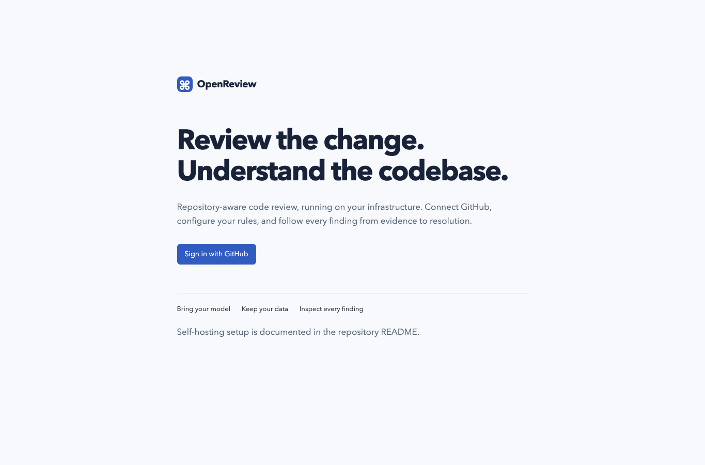

# OpenReview

OpenReview is an open-source, self-hostable, repository-aware AI pull request reviewer. It uses a GitHub App, Convex for durable application state and jobs, Next.js for the dashboard, and your model credentials. The same TypeScript review engine powers GitHub and the local CLI.

**Status:** implemented with passing local unit/integration, production browser, web build, and self-hosted Docker checks. Live GitHub installation and model quality require credentials and separate verification. This project makes no Greptile parity claims.

Documentation is published at `/docs` (Markdown in `docs/public/` plus selected guides), and the changelog at `/changelog`. Internal QA and acceptance logs live in `docs/internal/`.

## Architecture

```
GitHub App → signed Convex HTTP webhook → durable delivery → scheduled review
                                                        ↓
                 incremental blob index → code graph → ranked context
                                                        ↓
                  specialty reviewers → evidence checks → verifier
                                                        ↓
                    stored findings/usage → GitHub batch review
                                                        ↓
                     Next.js dashboard / authenticated API / MCP

Local Git branch → CLI → the same reviewChange engine
```

Repository content and model output are untrusted. Findings require exact source evidence and a changed-line location before a second model verification pass. Duplicate delivery IDs and review head SHAs are persisted. Reviews record stages and retries; publishing resumes stored results after failures.



## Local quickstart

Use Node.js 24 and pnpm 11.

```sh
pnpm install
CONVEX_AGENT_MODE=anonymous pnpm exec convex dev --once
pnpm setup:local
pnpm backend
# In another terminal:
pnpm dev
```

Open http://localhost:3000. Local setup generates independent session, service, and webhook secrets and synchronizes them to the local backend without printing their values. `.env.local` and `.env.backend` are ignored by Git. For provider/GitHub settings, edit `.env.local`, then run `pnpm setup:local` again. Backend changes must be deployed with `pnpm backend` or `convex dev --once`.

## GitHub App setup

Register your own GitHub App in GitHub Settings → Developer settings → GitHub Apps.

* Homepage: your `APP_URL`.
* User authorization callback: `APP_URL/api/auth/callback`.
* Setup URL: `APP_URL/api/github/callback`.
* Webhook URL: `NEXT_PUBLIC_CONVEX_SITE_URL/github/webhook`.
* Webhook secret: your `GITHUB_WEBHOOK_SECRET`.
* Repository permissions: Contents **read**, Metadata **read**, Pull requests **read/write**, Issues **read**, Checks **read**. No code-write permission is required.
* Subscribe to Installation, Installation repositories, Pull request, Pull request review, Pull request review comment, Issue comment, Push, and Repository events. Installation events are provided automatically where GitHub requires them.
* Enable user authorization during installation if desired; use the App's client ID/secret for sign-in.
* Generate a private key. Convert GitHub's PKCS#1 key to PKCS#8 with `openssl pkcs8 -topk8 -nocrypt -in github-key.pem -out app-key.pem`.

Set `GITHUB_APP_ID`, `GITHUB_APP_SLUG`, `GITHUB_APP_PRIVATE_KEY` (PKCS#8, literal `\n` accepted), `GITHUB_WEBHOOK_SECRET`, `GITHUB_CLIENT_ID`, and `GITHUB_CLIENT_SECRET`. Synchronize App credentials to Convex. Keep the App private key on server infrastructure only. Installation tokens are minted as needed and never persisted.

Sign in → create workspace → install App → choose authorized repositories in GitHub → save repository selection in workspace setup → configure behavior → enable selected repositories and start indexing → open a PR. Return to `/dashboard/onboarding` to resume saved selection and inspect progress, skipped files, revisions or retryable failures. Existing enabled repositories remain enabled when setup selection changes. Sign-in/installation state expires after ten minutes; sign in again if installation takes longer. GitHub webhooks need a public HTTPS backend URL; a localhost backend cannot receive public GitHub deliveries without a tunnel.

Supported follow-ups from repository collaborators with write/admin/maintain permission: `@openreview explain this`, `@openreview suggest a fix`, `@openreview what code depends on this`, `@openreview review again`, and `@openreview review security`. `@openreview ignore this pattern` in a finding thread saves an inspectable repository preference. `@openreview fix this` in a finding thread replies with a committable suggestion, checked against the current head before it is published, plus the Fix with your agent link. `@openreview fix this in a new PR` also opens a fix pull request from a new `openreview/fix-*` branch targeting the pull request's branch. This only happens when a workspace admin has enabled Fix pull requests for the repository and the GitHub App has Contents: Read and write. The pull request's own branch is never written, and changes from forks are skipped. Dashboard feedback/settings can reset preferences.

Follow-up answers retrieve current changed files and indexed dependencies/callers, then validate exact quoted source lines before publication. Source links pin the inspected revision. Historical reviews are unverified context; test source does not establish execution. Retrieval is bounded to 20 files and 40,000 characters, with generated/binary/secret files excluded. Invalid citations fail without posting and use the existing bounded recovery path. Model failures now record their usage as well as successful calls.

Optional **Checks: Read and write** lets OpenReview create an "OpenReview" check run, which is `in_progress` while reviewing and then completed with a short summary and a dashboard link. The **GitHub check run** setting keeps the conclusion `neutral` by default, or fails the check when verified findings reach a chosen severity (and passes otherwise). Installations that only grant Checks: Read keep working and simply skip check runs. PR comments use Pull requests write; the Issues read permission is required for the [issue-comment webhook subscription](https://docs.github.com/en/webhooks/webhook-events-and-payloads#issue_comment). See the [comment endpoint permissions](https://docs.github.com/en/rest/issues/comments#create-an-issue-comment).

Official setup references: [GitHub App permissions](https://docs.github.com/en/apps/creating-github-apps/registering-a-github-app/choosing-permissions-for-a-github-app), [GitHub App webhooks](https://docs.github.com/en/enterprise-cloud@latest/apps/creating-github-apps/registering-a-github-app/using-webhooks-with-github-apps).

## Models

Configure `LLM_PROVIDER=openai|anthropic|openrouter|compatible`, `LLM_MODEL`, and `LLM_API_KEY`. A compatible endpoint may run without a key if your server allows it. Set `LLM_BASE_URL` to its API base (for example `https://models.example.com/v1`). Responses must support JSON objects and validate against Zod schemas. Anthropic uses its native Messages API; other adapters use OpenAI-compatible chat completions. With `LLM_PROVIDER=anthropic` and no `LLM_MODEL`, reviews, verification and conversations use `claude-sonnet-5-5` and summaries and knowledge use `claude-haiku-5-5`.

The OpenAI and Anthropic adapters request native JSON-schema output (`LLM_STRUCTURED_OUTPUT=false` disables it); every response is still validated with Zod and repaired with bounded retries, and an endpoint that rejects the schema falls back to prompt-only JSON once. The shared review payload is sent as a stable prompt prefix: Anthropic receives `cache_control` breakpoints and OpenAI's automatic prefix caching applies, and cache reads and writes are recorded per model call. Output limits default to 6000 tokens, or 16000 for Claude and OpenAI reasoning models (which receive `max_completion_tokens`); override them with `LLM_MAX_OUTPUT_TOKENS` or `LLM_MAX_OUTPUT_TOKENS_<TASK>`. The engine also exposes native tool calling (`runTools`), which powers the experimental [agentic review engine](docs/agentic-review.md): set **Review engine** to `agentic` to let a read-only, tenant-scoped tool loop follow callers and definitions across files within per-mode budgets, with every finding passing the same grounding and verification gates as the default specialist pipeline.

`LLM_ALLOW_LOCAL=true` explicitly permits private/local endpoints, including local HTTP. This is an operator setting; end users cannot supply arbitrary model URLs. Cost estimates come from a built-in price table of current OpenAI and Anthropic models, or from `LLM_INPUT_COST_PER_MILLION` and `LLM_OUTPUT_COST_PER_MILLION` when set; a zero estimate for an unknown model means unknown pricing, not free inference. When an inference budget is active, only models with a built-in price on the official endpoint or an operator entry in `INFERENCE_PRICES` may run; everything else fails closed before any request is sent.

Task overrides include `LLM_MODEL_REVIEW`, `LLM_MODEL_VERIFY`, `LLM_MODEL_SUMMARY`, `LLM_MODEL_KNOWLEDGE`, and `LLM_MODEL_CONVERSATION`. Review depth adjusts context budgets: Fast 8k, Standard 16k, Deep 40k estimated tokens. Two simultaneous specialist calls bound inference concurrency. Provider rate limits and transient failures receive bounded backoff. Review cancellation stops between persisted stages; an already-running HTTP model call may finish.

Code graph: TypeScript/JavaScript use the TypeScript compiler, and Python, Go, Java, Kotlin, Rust, Ruby, C#, PHP, C/C++ and Swift use tree-sitter grammars. Import and call edges resolve to repository files, and reviews and the agentic engine use a ranked two-hop neighbourhood of callers and callees. See [docs/code-graph.md](docs/code-graph.md).

Review summary: each pull request (or GitLab merge request) has exactly one OpenReview summary comment. It is found by a hidden marker and edited in place on every run, while inline findings are posted as review comments; GitHub creates no review when there are no inline findings. Sections can be toggled per scope under Review formatting:
- overview
- a per-file table (file and one-line change description)
- a Mermaid sequence diagram, generated only when the change alters an interaction between at least two components; every arrow is backed by an exact source quote, OpenReview renders the Mermaid itself, and the diagram is omitted if validation fails
- an issues table (severity, linked location, title)
- a confidence score `n/5` with a one-sentence rationale, capped by the most severe verified finding
- risk assessment
- resolved findings
- skipped files
- test source

Test execution, coverage and a visible **Last reviewed commit** link always appear. Gitea, Bitbucket, Perforce and Origin keep posting one summary per run.

Reaction feedback: 👍 and 👎 on OpenReview finding comments count as feedback. A person who only gives 👍 marks the finding useful, and one who only gives 👎 marks it not useful. Each person's vote is recorded once and feeds the learned-preference system that dashboard feedback already uses. Bots never count. GitHub has no reaction webhooks, so reactions are polled when a pull request closes or merges and hourly for recently reviewed open pull requests. GitLab reactions arrive through award-emoji webhooks (enable "Emoji events" on the project hook). Analytics shows reaction counts per period.

Learned team conventions:
- **Ingestion:** each day OpenReview reads, incrementally and with bounds, the human review comments on newly merged GitHub pull requests in each enabled repository. Bots and trivial remarks are excluded.
- **Suggestion:** a model call (task `knowledge:conventions`, counted against the inference budget) extracts recurring conventions. Similar ones are clustered and stored as **suggested** rules with links to the supporting comments and a frequency count.
- **Approval:** administrators approve, reject or disable suggestions on the repository settings page, and every decision is audited. Auto-approval can be turned on per scope.
- **Use:** approved conventions reach reviews only as review guidance.
- **Guardrails:** text that would suppress findings, approve changes, touch permissions, secrets or budgets, or looks like prompt injection is rejected.

Memory management (Dashboard → Memory → Preferences): every learned preference and convention is listed with its provenance (source review, finding, feedback, developer request, or supporting comments), plus search and status filters. Workspace admins can edit the text, set the scope (this repository, its team, or the whole workspace), enable or disable, approve or reject suggestions, and delete. Every change is audit-logged. Viewers have read-only access. A team- or workspace-scoped entry applies to reviews in every repository in that scope, and disabling it takes effect everywhere at once. The guardrails apply to edits too, and a preference can never suppress security findings.

Codebase chat (Dashboard → Chat):
- **Asking:** ask questions across up to five indexed repositories you can access.
- **Investigation:** OpenReview uses the same read-only code tools as the agentic reviewer (search, read file, definitions, references, related files), bound to each repository's indexed revision. Investigation steps stream to the page as they happen.
- **Answers:** an answer is shown only after every `[n]` claim marker maps to a citation whose quote exactly matches lines OpenReview read at that revision. Each citation links to the provider pinned to that commit.
- **Threads:** threads are private to the member who started them, and follow-ups keep the thread's earlier turns as unverified context. If you lose access to a repository, answers that used it are hidden.
- **Limits and cost:** questions are rate-limited (6 per member and 30 per workspace per minute), count against the inference budget, and are recorded as `chat` usage.

Notifications (Settings → Notifications, see [docs/notifications.md](docs/notifications.md)): connect a Slack workspace, then link channels for review-completed and high-severity notifications. Optionally turn on Q&A, which answers `@OpenReview` questions about up to five linked repositories with the same cited-answer engine as Chat. `/openreview status` reports a channel's links. Members can opt in to email for their own pull requests or for every repository they can access; only verified addresses receive mail. Nothing is sent until Slack or email is configured.

Requirements context from Notion: connect a Notion workspace in Memory → Integrations. When a pull request links Notion pages that were shared with OpenReview, their text is read as read-only requirements, alongside Linear issues, Jira issues and Confluence pages. See [docs/notion.md](docs/notion.md). The Confluence space and Jira project pickers group resources by site, can be filtered, and support select all/none per site. They also flag selections that are no longer authorized.

Billing (cloud mode only, see [docs/billing.md](docs/billing.md)): when `BILLING_ENABLED=true`, a workspace gets a 14-day trial, then a Stripe per-seat subscription with a monthly review quota, grace for past-due payments, and Settings → Billing with Checkout and the Customer Portal. Self-hosted deployments leave it off and have no quotas.

Sign-in and accounts (see [docs/identity.md](docs/identity.md)): GitHub, GitLab, Google or an emailed magic link. Accounts link only when both sides have the same verified email. Server-side sessions can be revoked individually or all at once. Workspace removal signs the member out and revokes their API keys and bridges for that workspace. Admins can also invite by email with single-use, expiring links.

Azure DevOps (see [docs/azure-devops.md](docs/azure-devops.md)): connect an organization with a PAT or a Microsoft Entra service principal, and add service hooks secured by a shared-secret header. OpenReview computes diffs from the base and head blobs, posts findings as positioned comment threads, keeps one closed summary thread, and reports an `openreview` pull request status. Follow-up commands are not yet supported on Azure DevOps.

Repository configuration as code: `.openreview.json`, `.openreview/config.json`, `.openreview/rules.md` and nested per-directory `.openreview.json` files are read from the pull request's base revision. They are applied after workspace, team and repository dashboard settings, except keys an administrator locks. Invalid files produce visible warnings without blocking the review. See [docs/repo-config.md](docs/repo-config.md).

Triggers and filters (GitHub, configurable per workspace, team or repository):
- With **Automatic reviews** off, reviews run only on `@openreview review` or a trigger label.
- **Trigger labels** start a review on `pull_request.labeled` and keep re-reviewing labelled pull requests.
- **Excluded authors** are globs such as `dependabot[bot]` or `*-bot`.
- Changed-file and changed-line limits skip oversized automatic reviews, with a visible reason; an explicit `@openreview review` overrides the limits.
- Optional `style` and `syntax` categories are off by default.
- **Strictness** presets 1–3 set the confidence and severity thresholds: 1 = 0.95/high, 2 = 0.85/medium, 3 = 0.75/low.

Other providers keep their existing automatic-review filters.

Incremental review and thread hygiene (GitHub and GitHub Enterprise): when a push builds on the last reviewed commit (checked with the compare API), only the new commits' changes are reviewed. The full pull request stays available as context, and findings must still anchor on lines the pull request changes. Force-pushes, rebases and comparisons too large to complete fall back to a full review, and the summary's Coverage section says which mode ran. When a later review verifies that an earlier finding is fixed, OpenReview replies in its own thread and resolves it with the GraphQL `resolveReviewThread` mutation. Threads started by people are never resolved, and retries never reply twice.

Committable suggestions: a finding can carry a small exact replacement for its own line range. OpenReview publishes it only if the range lies inside the changed lines and the original text still matches the reviewed head revision; otherwise the suggestion is dropped (recorded in diagnostics) and the finding is kept. On GitHub and GitHub Enterprise, findings whose range lies inside one diff hunk are posted as multi-line comments (`start_line`…`line`); any other range falls back to its first line. GitHub and GitHub Enterprise render a ```` ```suggestion ```` block when the comment covers the whole suggestion range, and GitLab renders ```` ```suggestion:-N+M ````. Gitea, Bitbucket, Perforce and Origin show the finding and Fix handoff without a suggestion block, because they have no native apply-suggestion support.

Optional semantic retrieval: set `EMBEDDING_MODEL` with an OpenAI-compatible embedding endpoint and key (`EMBEDDING_BASE_URL`, `EMBEDDING_API_KEY`) that supports exactly 1,536 dimensions. Indexing embeds definition-level chunks (function, class or method boundaries from the code graph, with line windows as fallback). Reviews and the agentic `search_code` tool rank context with a hybrid of vector similarity, full-text relevance and code-graph proximity. Re-indexing backfills idempotently: unchanged files already embedded with the current model are skipped, and a model change re-embeds them. Embedding tokens and estimated cost are recorded as usage (`EMBEDDING_COST_PER_MILLION`, or the built-in price table). The repository settings page shows whether semantic retrieval is on. Without embeddings, full-text and graph retrieval still run.

## Environment

See [.env.example](.env.example) for the full variable list. Web and Convex must share `SESSION_SECRET` and `SERVICE_SECRET`. GitHub private key/webhook secret and model keys must exist in Convex's environment; setting them only in the web process is insufficient.

Convex local environment:

```sh
pnpm exec convex env set --from-file .env.backend
```

Self-hosted production environment:

```sh
CONVEX_SELF_HOSTED_URL=https://backend.example.com \
CONVEX_SELF_HOSTED_ADMIN_KEY='<admin-key>' \
pnpm exec convex env set --from-file .env.backend
```

Avoid printing secrets in logs, terminal transcripts, or CI output. Rotate session/service secrets together on both services.

## CLI

```sh
pnpm cli --help
pnpm cli review --base main
pnpm cli review --json
pnpm cli review --agent
pnpm cli review --security --mode deep
```

To install the `openreview` command from this checkout, run `npm link` (Node.js 24). Then run `openreview review --agent` from your repository. Local review compares committed HEAD with the merge base; commit your working changes first. Configure model credentials through the environment or `.env.local` in that repository. Local indexing respects ignored paths and limits eligible source to 5,000 files / 20 MB; it does not execute repository code.

Optional `.openreview.json`:

```json
{"rules":[{"id":"membership","instructions":"Every organization API must validate membership.","severity":"high","category":"security","globs":["src/api/**"],"enabled":true}]}
```

Generate an API key in dashboard Settings, then `openreview login --url https://review.example.com --token <key>` and `openreview status`. CLI configuration is saved with owner-only filesystem permissions. Local review works independently of server login.

For local agent fixes, install the selected Codex, Claude Code, or Cursor Agent CLI and sign in to it. Pair and register the checkout:

```sh
openreview bridge install
openreview bridge pair --url https://review.example.com
# Approve the displayed code in Settings → Personal agent.
openreview bridge register /absolute/path/to/repository
openreview bridge status
```

`bridge status` checks local agent availability even before pairing or while the server is unavailable. It also shows registered checkout counts when the local configuration is readable. An unpaired, unreadable, disconnected or rejected bridge retains a nonzero exit status with recovery instructions; this diagnostic command does not replace credentials or modify registered checkouts.

If dispatch says the agent started but its server status is unconfirmed, keep the terminal open and check its output before creating another Fix request. The bridge continues tracking the agent and retries launch reporting after successful completion. A reporting error does not establish agent failure or finding resolution; review the local diff and test output.

Cursor setup supports the official standalone `cursor-agent` CLI and falls back to the desktop `cursor agent` command. Keep the installed command on your terminal PATH; `bridge status` verifies its help command without authenticating or requesting inference.

Click Fix on an eligible finding or Fix All on the latest completed review. The registered checkout must match the repository and reviewed revision; existing uncommitted changes are preserved. Before releasing fix context, OpenReview checks the provider’s current open revision and rechecks workspace/repository authorization. A changed or closed PR, unavailable provider, revoked access, expired request or replay blocks dispatch. Re-review changed revisions before retrying. The portal shows launch, successful process exit, or failure, including nonzero exits and termination signals. A successful agent exit does not prove a correct fix or passing tests. Inspect the diff and test output, then commit and push yourself; the next review assesses resolution. Pairing credentials expire after 90 days and can be revoked in personal settings. Real macOS CLI dispatch, agent changes and regression checks have been verified for Codex, Claude Code and Cursor Agent; browser/protocol click acceptance is verified for Codex only. The remaining agent/OS acceptance matrix is still outstanding. Agents retain their native permission prompts and use their own authenticated accounts.

Without the bridge, every finding and the Fix page offer **Copy fix prompt**, plus **Open in Cursor**, **Open in Claude Code** and **Open in Codex** links. These use each agent's officially documented prompt deep link: `cursor://anysphere.cursor-deeplink/prompt`, `claude-cli://open` and `codex://new`. A link only pre-fills the prompt (with the repository when the agent supports it), and nothing runs until you send it. Prompts longer than an agent's link limit fall back to copy.

Workspace owners/admins set the default coding agent in Personal agents. Personal preferences inherit it until explicitly overridden; choose “Use workspace default” to reset an override. Review detail, individual findings, Fix All, and authenticated Fix links use the same effective preference. Viewers cannot pair bridges or launch fixes.

## API and MCP

API keys are hashed at rest, scoped to one workspace, and revocable. Use `Authorization: Bearer or_...`. Each key has a scope:
- **read:** query, search, repositories and reviews.
- **write:** adds requesting reviews, feedback and enabling repositories.
- **admin:** adds administrator endpoints.

The key owner's role still applies, and keys created before scopes keep full access. The full reference is [docs/openapi.yaml](docs/openapi.yaml).

* `POST /api/query` with `{question,repositoryIds,threadId?,stream?}`: a codebase answer with sources that exactly match lines at the indexed revision. Returns JSON, or Server-Sent Events when `stream` is true. `GET /api/query/:messageId` fetches a result later.
* `POST /api/search` with `{query,repositoryIds?,limit?}`: hybrid full-text and semantic search, returning ranked snippets.
* `POST /api/repositories` with `{repositoryId}` (write scope): enables an installed repository and indexes it. `GET /api/repositories/:id` returns its index status.
* `GET /api/repositories`
* `POST /api/p4/index` — admin-scoped metadata upload for manual submitted-revision indexing; see [Perforce setup](docs/perforce.md) and `openreview p4 upload --help`.
* `GET /api/reviews?cursor=...`
* `POST /api/reviews` with `{repositoryId,prNumber,headSha}`
* `GET /api/reviews/:id`
* `POST /api/findings/:id/feedback` with `{value,comment}`
* `GET /api/context?repositoryId=...&query=...`
* `GET /api/context?repositoryId=...&path=...`

Remote MCP (Streamable HTTP, no local install): point your client at `https://review.example.com/api/mcp` with the header `Authorization: Bearer or_...`. The endpoint is stateless and returns JSON responses. It rejects requests without a valid key (401 with `WWW-Authenticate: Bearer`). Each tool call runs through the public API, so the key's scope and workspace apply.

```json
{"mcpServers":{"openreview":{"type":"http","url":"https://review.example.com/api/mcp","headers":{"Authorization":"Bearer or_..."}}}}
```

Local stdio MCP:

```json
{"mcpServers":{"openreview":{"command":"pnpm","args":["--dir","/absolute/path/to/openreview","--silent","mcp"],"env":{"OPENREVIEW_URL":"https://review.example.com","OPENREVIEW_API_KEY":"or_..."}}}}
```

Both servers expose the same tools:
- **Reviews and findings:** `get_review`, `get_findings`, `get_finding`.
- **Repository context:** `get_repository_context`, `search_codebase` (paths and symbols), `get_related_files`, `get_custom_rules`, `list_repositories`.
- **Codebase questions and search:** `ask_codebase` (cited answers, as in `POST /api/query`) and `search_code` (hybrid semantic search, as in `POST /api/search`).
- **Feedback:** `mark_finding_resolved` (needs a write-scoped key). Keep keys in your client's secret configuration. Portable fix prompts support Codex, Claude Code, Cursor, and Fix All; they contain evidence and commit coordinates rather than relying on unverified application deep links.

## Self-hosting

See [deployment documentation](docs/deployment.md). Both web and Convex backend run on your infrastructure. Convex's open-source backend provides persistent scheduling and file storage. Source files use Convex storage blobs; file metadata, symbols, and relationships are indexed in tables.

## Local demo without GitHub

Configure the same model environment used by the CLI, then run `pnpm demo --fixture cross-file`. This simulates a known PR using the real review engine and writes actual results to `reports/demo.json` and `reports/demo.md`, including evidence, retrieved context, usage, and a portable fix prompt. `pnpm demo --list` lists the ten fixtures. No findings are seeded; zero findings remains a valid model result. The demo does not create production repository records or require a GitHub App.

## Optional runtime validation

From the committed target repository, an operator can run:

```sh
openreview runtime --image 'trusted-image@sha256:<digest>' --command 'npm test' --timeout 120 > runtime.json
```

Use a prebuilt image with offline dependencies. Network access is disabled. The helper sends the committed checkout into bounded container tmpfs, captures commit-bound JSON evidence, and exposes no host mounts/application secrets. Save its output to `runtime.json`, then use `openreview review --json --runtime-evidence runtime.json`. The CLI evidence file is operator-supplied local context and must match the committed HEAD. Hosted `POST /api/reviews` and direct review-request mutations reject caller-supplied runtime evidence; hosted results must come from a paired runtime worker with an authorized exact-revision job. Logs are redacted before persistence/inference and shown in review details. Execution is explicitly operator initiated or enabled through trusted administrator runtime policy, never triggered by repository instructions.

## Checks and evaluation

```sh
pnpm lint
pnpm typecheck
pnpm test
pnpm build
pnpm test:e2e # requires running local web and Convex services
pnpm eval
```

`pnpm test` runs unit and Convex integration tests. Browser checks authenticate a dedicated local fixture identity, visit onboarding/all dashboard sections, and save real rules/settings. They do not simulate successful GitHub OAuth or live inference. `pnpm eval` requires a real model and writes `reports/evaluation.json`; without credentials it exits with a blocked report, without inventing scores. `pnpm eval --validate` checks fixture identities, source/diff presence and expected finding locations without making model calls. The suite includes ten seeded defects and two behavior-preserving changes; clean fixtures contribute true negatives or false positives rather than missed bugs. Use `--fixture=<id>` for a targeted run. Evaluation scores use location/keyword matching and require human adjudication before quality claims. Provider/schema failures are unscored, return a nonzero exit code, and are reported separately from missed bugs.

## Troubleshooting

* Sign-in unavailable: configure GitHub client ID/secret and exact callback URL.
* Invalid installation state: sign in again and restart installation within ten minutes.
* No reviews: verify App permissions, webhook URL/secret, repository enabled status, draft behavior, branch filters, and automatic reviews.
* Model failures: ensure model env variables exist in Convex, verify endpoint/model support JSON output, and inspect persisted review errors.
* Failed indexing: inspect the repository error and retry indexing. Source-size limits are explicit; truncated GitHub trees are walked per subtree. Very large pull requests are reviewed risk-first within the mode's budget, and every skipped file is listed with its reason in the summary and review diagnostics.
* Unknown cost: set provider/model token prices.

See the [implementation and verification report](docs/implementation-status.md), [architecture](docs/architecture.md), [database](docs/database.md), [security policy](SECURITY.md), and [contributing](CONTRIBUTING.md).

For read-only issue requirements in PR reviews, see [Linear connection and resource scope](docs/linear.md) and [Atlassian Jira/Confluence setup](docs/atlassian.md).
